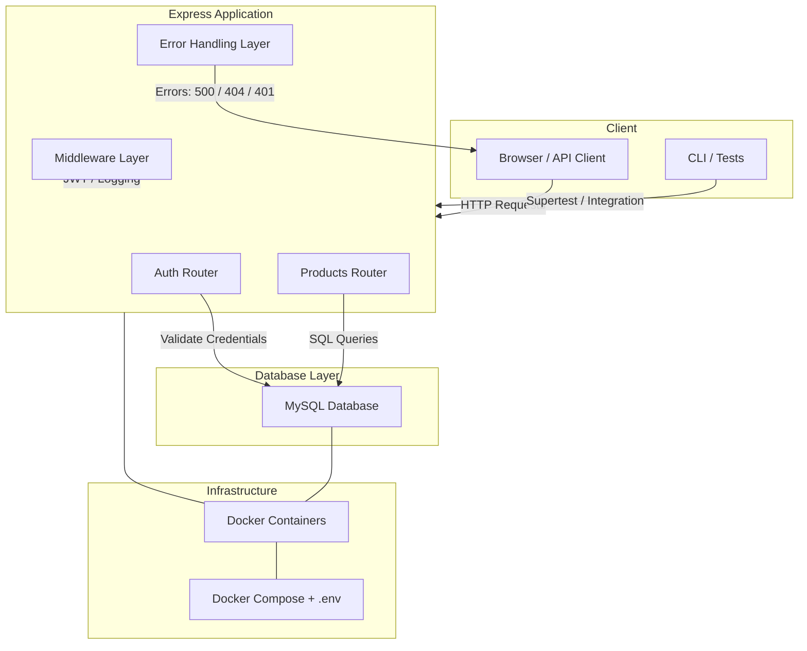

# Architecture

# Future Improvements

These are things I can do to improve the product in the case of full blown production environments

## 🔐 Security

* Use argon2 or bcrypt with salt + rounds

* Refresh tokens & rotation

* Role-based access (admin, user)

## 📊 Observability

* Add logging (pino or winston)

* Metrics with Prometheus + Grafana

* Request tracing (OpenTelemetry)

## ⚙️ Architecture

* Migrate DB layer to Prisma ORM (safer queries)

* Introduce service layer (separate business logic from routes)

* Container orchestration with Kubernetes for scaling

## 🚀 Scaling

* API Gateway / Load Balancer

* Caching layer (Redis) for products

* Full CI/CD pipeline with GitHub Actions
